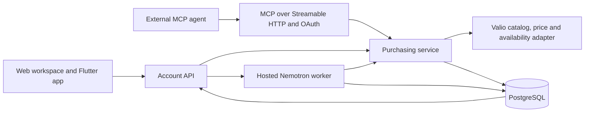

# Cosign system design

The React web workspace, Flutter app and MCP clients share the same buyer account. The default Express API calls a purchasing service that applies account rules, resolves supplier evidence and saves request revisions. PostgreSQL also stores OAuth grants, activity, rehearsal receipts and hosted assistant jobs.

## Evidence, approval and receipts

1. **Create a request.** The buyer or agent supplies quantities and requirements for up to ten lines. The service adds the account’s mandatory requirements. Requests can specify a budget, a delivery date or both.
2. **Compare offers.** The service searches its configured catalog, validates product requirements and stock units, then checks dated prices and availability for shortlisted products. It records the comparison revision and exposes gaps such as unknown stock, a closed cutoff or unverified delivery time. [Catalog setup](../../aimo_resources/README.md)
3. **Prepare a draft.** The service checks selections against the current comparison and account policy. Purchases outside automatic authority and revisions that relax hard constraints or omit requested lines need buyer approval. Changes to the comparison or account rules can invalidate earlier approvals.
4. **Record a rehearsal.** An authorized draft can be committed in an opted-in rehearsal workspace. The receipt records the fixed total, revision and authorizing decision. Retrying with the same key and revision returns the original receipt. The official challenge API supplies observations and has no documented order submission endpoint. [Valio integration](valio-integration.md#checkout-boundary) · [MCP order rehearsal](../production-mcp.md#order-rehearsal)

## Account access and activity

The signed-in browser session can approve or reject a draft. MCP clients use OAuth scopes for catalog access, request changes and rehearsal commitment. The account API derives identity and permissions from the session or token. The web workspace streams saved account events and can resume after a disconnect. The hosted Nemotron worker uses the same purchasing operations and persists progress when a job pauses for buyer review. [Agent connections](../production-mcp.md#agent-connections) · [State and authority](../production-mcp.md#state-and-authority)

## Development profiles

The legacy connected profile supports supplier comparison and Nemotron intake from text and photos. The separate fixture simulator demonstrates repricing and a delegated weekly purchase in its own database. [Developer setup](developer-setup.md#legacy-workspaces) · [Validation](../../validation/README.md)

## Code map

| Component | Entry point |
| --- | --- |
| React account workspace | [`client/src/trade/ProductionApp.tsx`](../../client/src/trade/ProductionApp.tsx) |
| Flutter client | [`mobile/lib/main.dart`](../../mobile/lib/main.dart) |
| Account API and MCP endpoint | [`server/src/trade/app.ts`](../../server/src/trade/app.ts) |
| Shared purchasing rules | [`server/src/trade/service.ts`](../../server/src/trade/service.ts) |
| Hosted assistant | [`server/src/trade/worker.ts`](../../server/src/trade/worker.ts) |
| Valio adapter | [`adapters/src/live.ts`](../../adapters/src/live.ts) |
| Database migrations | [`server/prisma/migrations/`](../../server/prisma/migrations/) |
